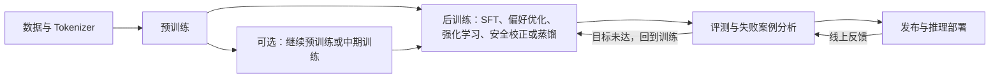

# 大模型训练流程

## 大模型完整训练链路

如果只看单个概念，`预训练`、`SFT`、`偏好对齐`、`部署` 很容易被理解成彼此独立；但从系统视角看，它们通常属于一条连续链路。

可以先用一句话概括：

`数据与 Tokenizer -> 预训练 ->（可选）继续预训练/中期训练 -> 后训练（SFT、偏好优化、强化学习或安全校正）-> 评测与迭代 -> 发布和推理部署`



这条链路里，每一阶段解决的问题并不一样：

- 预训练：让模型获得语言能力、知识和通用表示能力
- 后训练：让模型更适合指令、偏好、推理、工具使用和安全目标
- 评测与迭代：验证能力变化，定位回归和失败模式；指标说明见 [09 Benchmark与常见指标](09%20Benchmark%E4%B8%8E%E5%B8%B8%E8%A7%81%E6%8C%87%E6%A0%87.md)。
- 推理部署：让模型在真实系统里可用、可控、可负担。

这是一种常见的组织方式，不是所有团队都会使用相同阶段或固定顺序。后训练可能多轮进行，也可能按目标加入推理强化、蒸馏或专门的安全训练。

### 预训练与后训练的分工

预训练从大规模语料中学习通用语言模式、知识和表示能力，负责打底；后训练调整指令遵循、任务行为和偏好，把基础能力适配到具体交互、任务与约束。推理时计算、工具与检索同样会影响最终的任务表现。

因此，最终表现取决于数据、模型架构、训练计算、后训练目标和推理方式的组合。预训练影响很大，但不是唯一决定因素；它的资源开销见后文“训练为什么这么贵”。

## 预训练流程在做什么

### 数据准备

预训练的第一步不是直接开始训练，而是先准备大规模语料。

常见数据来源包括：

- 网页文本
- 书籍
- 代码
- 论文
- 问答语料
- 多语言文本

数据准备通常要做的事情包括：

- 去重
- 清洗脏数据
- 过滤低质量文本
- 去除明显无意义内容
- 控制不同语料的配比
- 必要时做数据增强和持续更新

这一阶段非常重要，因为：

- 垃圾数据会直接污染模型能力
- 数据分布会影响模型的知识结构和风格
- 数据质量问题会在后面被成倍放大

高质量、多样化的数据集，往往比“单纯堆更多数据”更重要。

真实训练数据管线还需管理来源和版本，并关注版权许可、个人信息、近重复内容、基准污染、多语言比例和领域覆盖。合成数据能补充稀缺任务，但需要过滤、去重和质量评估；未经检查地循环使用模型生成内容，可能放大原有错误和偏差。

### 数据配比与训练节奏

数据准备不只是清洗，还包括怎么喂：

- **配比**：网页、代码、书籍、多语言文本各占多少，会直接影响模型的能力偏向。提高代码占比通常被认为对推理和结构化输出有帮助，但会挤占其他语料的份额。
- **课程学习**：按先易后难或先通用后专业的顺序安排数据。实践中效果因任务而异，不是通用配方。
- **退火（annealing）**：在学习率衰减到接近零的最后阶段，集中灌入高质量、目标领域的数据。这一段的数据量占比很小，但对最终评测表现影响明显，也是各家配方差异最大的部分之一。

配比与节奏通常不会完整公开，因此复现论文结果时，数据侧往往是最大的不确定来源。

### Tokenization

原始文本不能直接送进神经网络，所以要先经过分词器，切成 token。

这一步和前面的 [2 Token.md](../1%20基础知识/2%20Token.md)、[3 Embedding.md](../1%20基础知识/3%20Embedding.md) 是连起来的：

1. 文本先被切成 token
2. token 再映射成 id
3. id 再查表变成向量
4. 向量进入 Transformer 计算

所以 tokenization 是训练链路里很靠前、但影响很深的一步。分词流程、切分算法、词表构成和特殊 Token 这些概念层面的内容见 [2 Token](../1%20基础知识/2%20Token.md)；这里只讲训练流程特有的几个决策。

**Tokenizer 必须在预训练开始前定下来。**它与模型权重是绑定关系：token id 的数量和含义直接决定 Embedding 层与输出层的形状。预训练结束后更换 Tokenizer，这两层参数就全部失效，等于要重训，因此实践中几乎不会更换。这也是为什么“支持某种语言”往往要从 Tokenizer 设计阶段就考虑。

**词表大小是一组权衡。**词表越大，同一段文本切出的 token 越少，序列更短、训练与推理更快，但 Embedding 层和输出层的参数量随之上升；词表越小则相反。多语言模型还要看各语言的压缩率是否均衡，否则某些语言会付出成倍的 token 成本。

**压缩率直接决定账单。**同一段中文在不同模型下的 token 数可能相差一倍以上，所以“训练用了多少 token”“推理一次多少钱”都必须用目标模型自己的 Tokenizer 实测，不能按字符数换算。

**序列打包影响训练效率。**预训练样本长短不一，常见做法是把多篇文档拼接后按固定长度切块（packing），以提高设备利用率。这时要用文档边界标记或 attention mask 隔开，避免模型把两篇无关文档当成连续上下文；具体实现取决于训练框架。

### 训练目标

对于自回归语言模型来说，最常见的预训练目标是：

**给定前文，预测下一个 token。**

例如：

```text
输入：今天天气很
目标：预测下一个 token
```

模型不会直接记一句完整标准答案，而是不断重复下面这个过程：

1. 读入一段上下文
2. 预测下一个 token 的概率分布
3. 计算预测和真实 token 之间的差距
4. 反向传播，更新参数

这是 Decoder-only 模型的目标，也是当前通用大模型的主流选择。其他骨干配套不同的预训练目标：

- Encoder-only（如 BERT）用掩码语言建模：随机遮住部分 token 让模型还原，得到双向上下文表示，常见于 Embedding 与分类模型。
- Encoder-Decoder（如 T5）把输入序列映射到输出序列，可用 span 掩码等目标训练，适合翻译、摘要这类输入输出边界清楚的转换任务。

目标与骨干是配套的，不能只看其中一个判断模型能力；三类结构的取舍见 [03 模型架构谱系](03%20%E6%A8%A1%E5%9E%8B%E6%9E%B6%E6%9E%84%E8%B0%B1%E7%B3%BB.md)。

### Loss 是怎么来的

预训练时，模型每一步都会输出一个对整个词表的预测分布。

如果真实下一个 token 是某个词，而模型给它的概率太低，就会产生更大的损失（loss）。

所以从直觉上看：

- 预测越准，loss 越低
- 预测越偏，loss 越高

训练的目标，就是不断让平均 loss 降下来。

这个损失通常就是交叉熵。把平均 loss 取指数得到困惑度（perplexity），衡量模型对这段文本的“意外程度”；它和 loss 是同一个量的两种刻度。

看 loss 时有两点容易误判：

- **loss 下降不等于能力线性提升。**训练 loss 衡量的是对语料分布的拟合程度，与下游任务表现之间没有稳定的换算关系，训练越到后期越明显。
- **验证 loss 可能被污染。**评测语料若与训练语料重叠，loss 会偏好；因此还要看真正 held-out 的数据和任务级评测，见 [09 Benchmark与常见指标](09%20Benchmark%E4%B8%8E%E5%B8%B8%E8%A7%81%E6%8C%87%E6%A0%87.md)。

### 规模、数据量与计算量怎么配

Scaling law 描述损失与模型参数量、训练 token 数、计算量之间的经验关系。Chinchilla 的结论是：给定计算预算时，参数量和训练 token 数应当同比例增长，经验值约为每参数 20 个 token。

由此产生两个实践后果：

- **早期的大模型普遍“训练不足”**：参数量大而 token 数不够，没有用满计算预算。
- **现代做法反而刻意“过训练”小模型**：推理成本会随参数量在整个生命周期里持续累积，用远超 20 token/param 的数据训练一个较小模型，总拥有成本往往更低。LLaMA 系列是这一思路的代表。

MoE 是改变这个权衡的另一条路线：稀疏激活让总参数量远大于每 token 的实际计算量，于是在相同计算预算下可以容纳更多参数。代价是显存与通信开销按总参数量计，路由均衡和训练稳定性也更难保证，见 [03 模型架构谱系](03%20%E6%A8%A1%E5%9E%8B%E6%9E%B6%E6%9E%84%E8%B0%B1%E7%B3%BB.md)。

所以 scaling law 是权衡工具而不是配方：它告诉你计算预算怎么分配，但最优比例取决于你更在意训练成本还是推理成本。

### 训练为什么这么贵

从头训练大规模模型时，预训练通常是资源消耗最大的阶段之一，但并非所有项目都如此；大规模后训练，尤其是多轮生成式强化学习，也可能占用显著资源。成本会受到训练 Token 数、序列长度、模型规模、训练步数、硬件利用率和实验次数共同影响。

Transformer 训练会在大量 Token 上反复计算和更新参数，并不只是“把数据读一遍”；参数都花在哪、注意力为什么是平方复杂度，见 [1 Transformer](1%20Transformer.md)。评估训练成本时，还要把失败实验、重跑和后训练纳入整体预算——参数量本身不足以推断总成本。

## 训练怎么跑起来

前面讲的是训练在优化什么，这一节讲训练跑在什么之上。对使用 API 的人它不直接可见，但它决定了模型能做多大规模、迭代多快、一次实验要多少钱。

### 显存都花在哪

一个常见误解是用参数量直接推算显存：7B 参数 × 2 字节（BF16）≈ 14 GB，于是一张 24 GB 的卡就能训。实际远不止于此。

| 组成 | 说明 | 量级（BF16 训练 + AdamW） |
| --- | --- | --- |
| 模型参数 | 前向与反向都要用 | 2 字节/参数 |
| 梯度 | 每个参数一份 | 2 字节/参数 |
| 优化器状态 | AdamW 的一阶、二阶动量通常用 FP32，另有一份 FP32 主权重 | 约 12 字节/参数 |
| 激活值 | 前向过程的中间结果，供反向使用 | 随 batch、序列长度、层数变化 |

前三项合计约 16 字节/参数，7B 模型就是 112 GB 左右，还没算激活值。这就是全参数训练大模型必须多卡的原因，也是 ZeRO、FSDP 与参数高效微调存在的直接动机：LoRA/QLoRA 只更新一小部分参数，梯度和优化器状态的开销随之大幅下降，见 [07 微调](07%20%E5%BE%AE%E8%B0%83.md)。

激活值还可以用重计算（gradient checkpointing）换回来：反向传播时重新算一遍前向，用计算时间换显存。

### 三种并行方式

单卡放不下时，就要把训练切开：

- **数据并行（DP）**：每张卡持有完整模型副本，各自处理不同数据，再同步梯度。实现最简单，但要求单卡装得下整个模型。
- **张量并行（TP）**：把单层内部的矩阵切到多张卡上，一次前向就要跨卡通信。通信量大，通常只在同一台机器的高速互联内使用。
- **流水线并行（PP）**：把不同的层放到不同卡上，像流水线一样传递激活值。跨机通信少，但会产生“气泡”（部分设备空闲），需要微批次来缓解。
- **ZeRO / FSDP**：不切分计算，而是把参数、梯度和优化器状态分片到各卡，用到时再临时聚合，可以理解为“省显存的数据并行”。

大规模训练通常几种同时使用（所谓 3D 并行），切分方式由训练框架和集群拓扑共同决定。

### 混合精度与梯度累积

- **混合精度**：前向与反向用 BF16/FP16 计算以省显存、提速度，同时保留一份 FP32 主权重用于参数更新，避免小幅更新被舍入掉。BF16 的指数范围与 FP32 相同，训练稳定性通常优于 FP16。
- **梯度累积**：显存装不下目标 batch 时，连续跑多个小 batch、把梯度累加后再更新一次，效果等价于更大的 batch，代价是单步耗时变长。

### 关键超参

- **学习率与调度**：常见做法是 warmup 线性升到峰值，再按余弦曲线衰减。学习率过大是 loss 尖峰和发散的常见原因。
- **批大小与序列长度**：共同决定单步看到多少 token，批大小还影响梯度噪声与优化稳定性。
- **训练 token 总量**：与参数量一起决定计算预算，见上文的 scaling law。
- **权重衰减与梯度裁剪**：主要用于抑制过拟合与训练不稳定。

这些超参相互牵制，公开配方未必能直接迁移到不同规模或不同数据分布上。

### Checkpoint 与训练稳定性

大规模训练通常按小时级间隔保存 checkpoint，并要求能从最近一次恢复。原因很现实：

- 集群规模越大，单点故障概率越高，长时间训练中断几乎是必然事件。
- loss 尖峰、梯度爆炸、NaN 可能需要回滚到更早的 checkpoint，或跳过某批问题数据。
- 每次重跑的代价以小时和金钱计，checkpoint 频率是“恢复损失”与“写盘开销”之间的权衡。

这也解释了为什么训练成本不能只看一次理想运行：失败实验、重跑与故障恢复通常占相当比例。

## 预训练之后发生什么

### 微调在链路里的位置

预训练后的模型本质上更像一个通用续写器：它可能有知识，但不一定擅长按角色回答、按格式输出、遵循任务约束或以助手方式互动。后训练补的就是这一段。

**微调不是单一方法名，而是一类适配过程。**它有两条互相独立的分类轴，混用是大多数误解的来源：

- 训练目标与阶段：继续预训练、SFT、领域微调、偏好优化。
- 参数更新方式：Full Fine-tuning、LoRA、QLoRA、Adapter。

同一个 SFT 任务既可以用全参数微调完成，也可以用 LoRA 完成。狭义的“微调”通常专指 SFT，广义上则泛指在基础模型上继续做的任何参数训练。两条轴的完整辨析与各方法取舍见 [07 微调](07%20%E5%BE%AE%E8%B0%83.md)。

### 指令微调（SFT）

SFT（Supervised Fine-Tuning）使用带有目标输出的监督样本继续训练模型。常见数据是“指令-回答”对，也可以包括多轮对话、结构化输出、工具调用或其他任务样本。训练数据定义了希望模型学习的行为，实际效果取决于样本质量、覆盖范围和训练目标。

可以把它理解为：

- 预训练解决“模型会不会语言和知识”
- SFT 解决“模型会不会按要求回答”

### 偏好对齐

SFT 之后，模型已经能回答问题，但“能回答”和“回答得更好”不是一回事。

所以很多模型还会继续做偏好对齐，目标通常包括：

- 更安全
- 更有帮助
- 更符合人类偏好
- 在推理和工具使用中表现更稳定

常见方法包括：

- 奖励模型 + RLHF
- DPO 等偏好优化方法
- PPO、GRPO 等策略优化方法

后训练阶段的范围和术语边界见 [06 后训练概述.md](06%20%E5%90%8E%E8%AE%AD%E7%BB%83%E6%A6%82%E8%BF%B0.md)，强化学习方法见 [08 强化学习.md](08%20%E5%BC%BA%E5%8C%96%E5%AD%A6%E4%B9%A0.md)。

### 蒸馏与能力迁移

蒸馏是利用教师模型的输出、评分、轨迹或中间监督信号训练学生模型的一类方法。常见目标是把较强模型的能力迁移到更小、更便宜或更适合特定部署环境的模型中。

蒸馏可以发生在后训练流程的不同位置，也常用于推理模型家族的轻量版本。它不等于简单缩小参数量：学生模型需要在目标任务上重新评估，还要检查错误类型、格式稳定性和安全表现。蒸馏与 LoRA 等参数高效微调解决的是不同问题。

## 继续预训练、领域微调、RAG 的区别

这几个概念经常被混在一起，但它们不属于同一层。

### 继续预训练

继续预训练（continued pretraining）指的是：

在已有基础模型上，再用特定领域的大规模语料继续做预训练。

一些团队会把预训练结束后、指令微调前的一段高质量混合语料训练称为中期训练（mid-training）。术语边界并未完全统一；理解时重点看训练目标、数据分布和它在整体训练链路中的位置。

它更适合解决：

- 模型缺少某个领域的语言分布
- 模型对某类文本风格不熟
- 希望增强领域知识基础

例如：

- 法律文本
- 医学文献
- 金融报告
- 企业内部专业文档

### 领域微调

领域微调更像是：在特定任务样本上，让模型学会该领域里的具体输出方式。

它更偏：

- 任务适配
- 指令适配
- 输出风格适配

所以可以粗略理解为：

- 继续预训练：补领域基础知识和语言分布
- 领域微调：补领域任务表现

### RAG

RAG 通常是一种运行时应用模式，而不是把外部知识写入生成模型参数的训练阶段。检索器、重排器和生成模型本身仍可单独训练或微调；这里讨论的是典型 RAG 系统的使用流程。

它的核心思路是：

- 先从外部知识库检索相关内容
- 再把这些内容放进上下文
- 最后让模型基于这些内容回答

所以 RAG 解决的是：

**模型不需要把所有知识都重新训练进参数里，也能在回答时访问外部知识。**

### 工具调用

工具调用横跨训练与运行时：后训练可教模型判断何时调用工具并生成结构化调用；运行时系统负责校验、授权和执行调用，并把结果返回给模型。实际执行 API 或代码属于应用/Agent 运行层，不是模型训练阶段本身。

它解决的是：

- 查询外部系统
- 执行代码
- 访问数据库
- 调用 API

因此不要把继续预训练、微调、RAG 和工具调用看成同一类事情：继续预训练和微调会更新模型参数；RAG 与工具执行属于运行时架构，而模型如何发起工具调用可以通过后训练学习。

## 训练完成后为什么还要部署优化

模型训练完成，不代表系统就能直接上线。

推理部署还要解决很多工程问题，例如：

- 延迟
- 成本
- 吞吐
- 显存占用
- 并发
- 安全与权限控制

这也是为什么一个模型“效果很好”，不一定意味着它“系统可用”。

训练阶段影响能力形成，部署阶段决定这些能力能否稳定提供给真实用户。延迟、吞吐、量化和服务架构等内容见 [推理与部署](../../04%20%E6%8E%A8%E7%90%86%E4%B8%8E%E9%83%A8%E7%BD%B2/README.md)。

## 一句话总结

训练是一条链路，不是一个步骤：数据与 Tokenizer 决定模型看到什么，预训练用大量计算换取通用建模能力，后训练把这种能力对齐到指令、偏好与安全目标，评测决定要不要再来一轮，部署决定这些能力能否稳定交付。看任何一个阶段时，都值得同时问三件事——它在优化什么目标、消耗什么资源、输出会被下一阶段怎么用。

## 参考资料

- [Training Compute-Optimal Large Language Models](https://arxiv.org/abs/2203.15556)：计算量、参数规模与训练 Token 的权衡。
- [Training language models to follow instructions with human feedback](https://arxiv.org/abs/2203.02155)：指令微调与 RLHF 的公开实践。
- [Direct Preference Optimization: Your Language Model is Secretly a Reward Model](https://arxiv.org/abs/2305.18290)：基于偏好数据的直接优化方法。
- [DeepSeek-R1](https://arxiv.org/abs/2501.12948)：推理模型后训练与强化学习的公开实践。
- [Language Models are Few-Shot Learners (GPT-3)](https://arxiv.org/abs/2005.14165)：规模化自回归预训练的公开配方。
- [LLaMA: Open and Efficient Foundation Language Models](https://arxiv.org/abs/2302.13971)：小模型配合远超 Chinchilla 比例的 token 数训练。
- [PaLM: Scaling Language Modeling with Pathway](https://arxiv.org/abs/2204.02311)：大规模训练的工程实践与问题记录。
- [The Pile: An 800GB Dataset of Diverse Text for Language Modeling](https://arxiv.org/abs/2101.00027)：公开预训练语料的构成示例。
- [ZeRO: Memory Optimizations Toward Training Trillion Parameter Models](https://arxiv.org/abs/1910.02054)：优化器状态、梯度与参数分片。
- [Megatron-LM: Training Multi-Billion Parameter Language Models Using Model Parallelism](https://arxiv.org/abs/1909.08053)：层内张量并行。
- [Efficient Large-Scale Language Model Training on GPU Clusters Using Megatron-LM](https://arxiv.org/abs/2104.04473)：数据、张量、流水线并行的组合方式。
- [Training Deep Nets with Sublinear Memory Cost](https://arxiv.org/abs/1604.06174)：激活值重计算的理论基础。
- [Switch Transformers: Scaling to Trillion Parameter Models with Simple and Efficient Sparsity](https://arxiv.org/abs/2101.03961)：MoE 的稀疏激活与训练稳定性。
