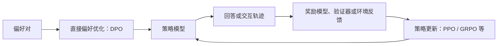

# 大模型强化学习与偏好优化

## 强化学习在大模型训练中的位置

强化学习（Reinforcement Learning，RL）是后训练中的一种可选方法，常用于根据奖励信号优化模型行为。它通常接在预训练或监督微调（SFT）之后，但模型训练并不一定包含 RL；具体阶段可以按目标组合，也可能多轮迭代。

一条常见但并非固定的路径是：

`预训练 ->（可选）继续预训练 -> SFT ->（可选）偏好优化、RL 或安全训练 -> 评测`

RL 可用于偏好对齐、可验证推理任务和工具交互等场景。它与直接偏好优化有关，但两者并非同一类更新过程。完整训练阶段见 [05 大模型训练流程](05%20%E5%A4%A7%E6%A8%A1%E5%9E%8B%E8%AE%AD%E7%BB%83%E6%B5%81%E7%A8%8B.md) 和 [06 后训练概述](06%20%E5%90%8E%E8%AE%AD%E7%BB%83%E6%A6%82%E8%BF%B0.md)；SFT 见 [07 微调](07%20%E5%BE%AE%E8%B0%83.md)。

### 为什么 SFT 之后还会使用 RL

SFT 使用示例教模型模仿目标输出，但开放任务通常没有唯一标准答案。两个答案都可能正确，却在清晰度、安全性或任务完成度上不同；多步任务也可能需要评估整段回答或交互轨迹。

偏好数据、规则验证器或环境反馈可以提供不同于单一参考答案的训练信号。它们能帮助模型调整策略，但训练效果取决于信号是否可靠。

### RL 概念在 LLM 中的对应关系

| 概念 | 在 LLM 中的常见含义 |
| --- | --- |
| Policy | 当前生成模型及其生成策略 |
| Action | 生成 Token、回答，或发起一次工具调用 |
| Environment | Prompt、任务规则、工具及其返回结果 |
| Reward | 人工偏好模型、规则验证器或环境结果给出的分数 |
| Rollout | 模型生成回答或完成一段多步交互轨迹 |

奖励信号可能来自人类偏好、奖励模型、可验证的答案或工具执行结果。代理指标也可能被模型利用（reward hacking）；长回答或多步任务还存在“最终结果不错，但难以判断是哪一步起作用”的归因问题。因此需要独立评测，不能只看训练奖励。

## RLHF 与直接偏好优化

### 经典 RLHF 流程

RLHF（Reinforcement Learning from Human Feedback）广义上指利用人类反馈改进模型的训练流程。经典流程通常包括：

1. 用 SFT 得到基础指令模型。
2. 收集人工偏好数据，例如对同一问题比较两个回答。
3. 用偏好数据训练奖励模型（Reward Model，RM）。
4. 让策略模型生成回答或交互轨迹，再由奖励模型或任务验证器评分。
5. 用 PPO 等策略优化方法更新模型，并持续评测。

不同团队的流程可能省略、替换或重复其中的阶段。奖励模型也不是所有偏好训练方法的必需组件。

### 奖励模型

奖励模型通常是独立于策略模型的打分器，根据偏好数据学习对回答或轨迹进行评分。它提供的是训练用的代理信号，不保证分数完全代表事实正确性或真实用户价值；策略过度优化该分数可能导致奖励投机。

### Rollout

Rollout 是当前策略实际生成样本并与任务环境交互的过程。在简单问答中，它可能是一条回答；在 Agent 任务中，它可以包含多轮的模型动作、工具调用、工具返回和最终结果。奖励既可以在最终结果上计算，也可以对中间步骤评分。

### DPO 与 RLHF 的关系

DPO（Direct Preference Optimization）直接使用“偏好回答 / 非偏好回答”样本优化策略，常见实现不需要单独训练奖励模型，也不需要像 PPO 那样反复在线采样和更新。

因此，DPO 是直接偏好优化方法；PPO、GRPO 等则根据奖励或相对优势更新策略。广义上它们都可用于人类反馈后的对齐，但 DPO 不等于经典的“奖励模型 + 在线 RL”流程。更多术语边界见 [06 后训练概述](06%20%E5%90%8E%E8%AE%AD%E7%BB%83%E6%A6%82%E8%BF%B0.md)。

## 常见策略优化方法

### PPO

PPO（Proximal Policy Optimization）通过裁剪策略更新幅度，降低单次更新过大造成的不稳定。经典 RLHF 流程常用奖励模型提供分数，并用价值模型（critic）估计状态价值，以计算优势。

PPO 是重要的基线方法，但通常需要策略采样、奖励计算和价值估计等组件；对大模型而言，显存与工程成本较高。裁剪机制也不意味着训练一定稳定或奖励一定可靠。

### GRPO

GRPO（Group Relative Policy Optimization）对同一输入采样一组回答，根据组内奖励相对关系估计优势。典型实现不需要单独训练 PPO 式的价值模型，因此可以减少一部分模型状态和显存开销。

它仍需要生成多个候选回答；如果采样结果过于相似或奖励相同，组内训练信号会变弱。实际成本还取决于采样数量、回答长度和奖励评估方式。

### GSPO

GSPO（Group Sequence Policy Optimization）属于组相对策略优化方向。它把重要性比率和裁剪的粒度从 Token 级改为序列级；这不等于只给整段文本一个分数，也不表示不再计算 Token 概率。

它调整的是策略更新的粒度，是否改善训练稳定性或效率需要结合模型、任务和论文中的评测结果判断。

### DAPO

DAPO（Decoupled Clip and Dynamic Sampling Policy Optimization）是面向推理任务的一套 GRPO 类训练方案，包含非对称裁剪、动态采样、Token 级策略损失和过长回答奖励塑形等组件。

DAPO 因此不只是一个独立的“工程增强层”；它是一组结合策略目标、采样和奖励设计的训练改动。不同实现采用的组件和配置应以对应论文或代码为准。

## 方法对照与选择

| 方法 | 主要训练信号与做法 | 需要留意的成本或限制 |
| --- | --- | --- |
| DPO | 离线偏好对，直接优化偏好回答与非偏好回答的相对倾向 | 受偏好数据覆盖和分布影响；典型实现不走在线 RL 回路 |
| PPO | 奖励模型或验证器提供分数，再用裁剪策略更新 | 常需要 critic 和大量 rollout，训练链路较重 |
| GRPO | 对同一输入的一组样本使用组内相对奖励 | 减少对独立 critic 的依赖，但采样和奖励评估仍有成本 |
| GSPO | 组相对信号配合序列级重要性比率与裁剪 | 属于策略更新变体，收益依赖模型和任务 |
| DAPO | GRPO 类目标配合裁剪、动态采样和奖励塑形等组件 | 属于训练方案组合，不能只凭名称推断各组件都适用 |

研究方法更新很快；以上是有代表性的路线，不是穷尽列表。比较时应核对原始论文、训练信号、是否在线采样、奖励来源和同一评测条件，不要把算法、训练配方和应用场景混成一组平级名称。

## RL 的能力边界与评估

RL 可以在奖励信号与任务目标匹配时，改善模型的策略、推理任务表现或工具使用；它不能可靠地替代基础模型训练，也不能保证补齐缺失知识。训练结果还可能偏向代理奖励而损害其他能力。

评估时应同时检查目标任务成功率、奖励投机、分布外表现、安全性和回归情况，并与未使用该训练方法的基线对照。常见评测指标见 [09 Benchmark与常见指标](09%20Benchmark%E4%B8%8E%E5%B8%B8%E8%A7%81%E6%8C%87%E6%A0%87.md)。

## 参考资料

- [Training language models to follow instructions with human feedback](https://arxiv.org/abs/2203.02155)：InstructGPT 的指令微调与 RLHF 流程。
- [Proximal Policy Optimization Algorithms](https://arxiv.org/abs/1707.06347)：PPO。
- [Direct Preference Optimization: Your Language Model is Secretly a Reward Model](https://arxiv.org/abs/2305.18290)：DPO。
- [DeepSeekMath: Pushing the Limits of Mathematical Reasoning in Open Language Models](https://arxiv.org/abs/2402.03300)：GRPO。
- [DeepSeek-R1: Incentivizing Reasoning Capability in LLMs via Reinforcement Learning](https://arxiv.org/abs/2501.12948)：推理任务的强化学习实践。
- [DAPO: An Open-Source LLM Reinforcement Learning System at Scale](https://arxiv.org/abs/2503.14476)：DAPO 训练方案。
- [Group Sequence Policy Optimization](https://arxiv.org/abs/2507.18071)：GSPO。
