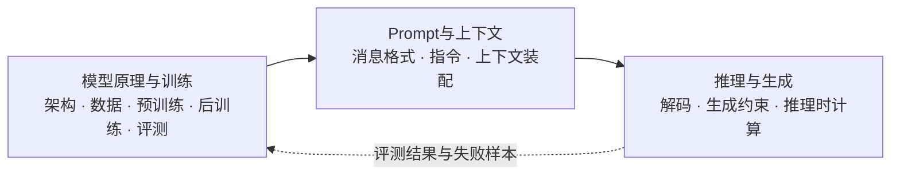

# 01 大模型基础

本领域按模型生命周期组织基础知识，回答三个问题：模型如何形成、一次请求如何组织、模型如何生成与推理。三部分构成应用开发前的模型知识主干。

## 推荐的三层结构

### 1. 模型原理与训练

从模型结构、Token 表示和训练生命周期出发，理解基础模型、指令模型、推理模型以及专用模型的能力来源。按“模型与架构 → 训练与适配 → 评测”学习。

### 2. Prompt与上下文

从一次请求的输入侧理解 Prompt、对话模板、上下文窗口、上下文工程、压缩与缓存。重点是把任务要求、可信资料和历史状态组织成模型可处理的上下文。

### 3. 推理与生成

从一次请求的输出侧理解自回归生成、采样与解码、结构化输出，以及通过更多推理时计算提升复杂任务表现的做法。推理策略的选择需要结合质量、延迟和成本评估。

## 推荐学习路径

1. **理解模型**：[01 LLM基本概念](模型原理与训练/01%20LLM%E5%9F%BA%E6%9C%AC%E6%A6%82%E5%BF%B5.md) → [02 Transformer](模型原理与训练/02%20Transformer.md) → [03 模型架构谱系](模型原理与训练/03%20%E6%A8%A1%E5%9E%8B%E6%9E%B6%E6%9E%84%E8%B0%B1%E7%B3%BB.md) → [04 Embedding](模型原理与训练/04%20Embedding.md)。
2. **理解模型如何训练与验证**：[05 大模型训练流程](模型原理与训练/05%20%E5%A4%A7%E6%A8%A1%E5%9E%8B%E8%AE%AD%E7%BB%83%E6%B5%81%E7%A8%8B.md) → [06 后训练概述](模型原理与训练/06%20%E5%90%8E%E8%AE%AD%E7%BB%83%E6%A6%82%E8%BF%B0.md) → [07 微调](模型原理与训练/07%20%E5%BE%AE%E8%B0%83.md) → [08 强化学习](模型原理与训练/08%20%E5%BC%BA%E5%8C%96%E5%AD%A6%E4%B9%A0.md) → [09 Benchmark与常见指标](模型原理与训练/09%20Benchmark%E4%B8%8E%E5%B8%B8%E8%A7%81%E6%8C%87%E6%A0%87.md)。
3. **组织一次请求**：[01 Prompt Engineering](Prompt%E4%B8%8E%E4%B8%8A%E4%B8%8B%E6%96%87/01%20Prompt%20Engineering.md) → [02 对话模板与上下文装配](Prompt%E4%B8%8E%E4%B8%8A%E4%B8%8B%E6%96%87/02%20%E5%AF%B9%E8%AF%9D%E6%A8%A1%E6%9D%BF%E4%B8%8E%E4%B8%8A%E4%B8%8B%E6%96%87%E8%A3%85%E9%85%8D.md) → [03 Context Engineering](Prompt%E4%B8%8E%E4%B8%8A%E4%B8%8B%E6%96%87/03%20Context%20Engineering.md) → [04 上下文压缩](Prompt%E4%B8%8E%E4%B8%8A%E4%B8%8B%E6%96%87/04%20%E4%B8%8A%E4%B8%8B%E6%96%87%E5%8E%8B%E7%BC%A9.md) → [05 Prompt Cache](Prompt%E4%B8%8E%E4%B8%8A%E4%B8%8B%E6%96%87/05%20Prompt%20Cache.md)。
4. **控制生成与推理**：[01 生成策略与输出控制](推理与生成/01%20%E7%94%9F%E6%88%90%E7%AD%96%E7%95%A5%E4%B8%8E%E8%BE%93%E5%87%BA%E6%8E%A7%E5%88%B6.md) → [02 推理时计算与推理模型](推理与生成/02%20%E6%8E%A8%E7%90%86%E6%97%B6%E8%AE%A1%E7%AE%97%E4%B8%8E%E6%8E%A8%E7%90%86%E6%A8%A1%E5%9E%8B.md) → [03 CoT 提示方法](推理与生成/03%20CoT.md) → [04 Self-Ask 子问题分解](推理与生成/04%20Self-Ask.md) → [05 ToT](推理与生成/05%20ToT.md)。

## 文档目录

### 模型原理与训练

#### 模型与架构

- [01 LLM基本概念](模型原理与训练/01%20LLM%E5%9F%BA%E6%9C%AC%E6%A6%82%E5%BF%B5.md)
- [02 Transformer](模型原理与训练/02%20Transformer.md)
- [03 模型架构谱系](模型原理与训练/03%20%E6%A8%A1%E5%9E%8B%E6%9E%B6%E6%9E%84%E8%B0%B1%E7%B3%BB.md)
- [04 Embedding](模型原理与训练/04%20Embedding.md)

#### 训练与适配

- [05 大模型训练流程](模型原理与训练/05%20%E5%A4%A7%E6%A8%A1%E5%9E%8B%E8%AE%AD%E7%BB%83%E6%B5%81%E7%A8%8B.md)
- [06 后训练概述](模型原理与训练/06%20%E5%90%8E%E8%AE%AD%E7%BB%83%E6%A6%82%E8%BF%B0.md)
- [07 微调](模型原理与训练/07%20%E5%BE%AE%E8%B0%83.md)
- [08 强化学习](模型原理与训练/08%20%E5%BC%BA%E5%8C%96%E5%AD%A6%E4%B9%A0.md)
- [微调工具：01 Unsloth](模型原理与训练/%E5%BE%AE%E8%B0%83%E5%B7%A5%E5%85%B7/01%20Unsloth.md)

#### 评测

- [09 Benchmark与常见指标](模型原理与训练/09%20Benchmark%E4%B8%8E%E5%B8%B8%E8%A7%81%E6%8C%87%E6%A0%87.md)

### Prompt与上下文

- [01 Prompt Engineering](Prompt%E4%B8%8E%E4%B8%8A%E4%B8%8B%E6%96%87/01%20Prompt%20Engineering.md)
- [02 对话模板与上下文装配](Prompt%E4%B8%8E%E4%B8%8A%E4%B8%8B%E6%96%87/02%20%E5%AF%B9%E8%AF%9D%E6%A8%A1%E6%9D%BF%E4%B8%8E%E4%B8%8A%E4%B8%8B%E6%96%87%E8%A3%85%E9%85%8D.md)
- [03 Context Engineering](Prompt%E4%B8%8E%E4%B8%8A%E4%B8%8B%E6%96%87/03%20Context%20Engineering.md)
- [04 上下文压缩](Prompt%E4%B8%8E%E4%B8%8A%E4%B8%8B%E6%96%87/04%20%E4%B8%8A%E4%B8%8B%E6%96%87%E5%8E%8B%E7%BC%A9.md)
- [05 Prompt Cache](Prompt%E4%B8%8E%E4%B8%8A%E4%B8%8B%E6%96%87/05%20Prompt%20Cache.md)
- [06 编程提示词](Prompt%E4%B8%8E%E4%B8%8A%E4%B8%8B%E6%96%87/06%20%E7%BC%96%E7%A8%8B%E6%8F%90%E7%A4%BA%E8%AF%8D.md)

### 推理与生成

- [01 生成策略与输出控制](推理与生成/01%20%E7%94%9F%E6%88%90%E7%AD%96%E7%95%A5%E4%B8%8E%E8%BE%93%E5%87%BA%E6%8E%A7%E5%88%B6.md)
- [02 推理时计算与推理模型](推理与生成/02%20%E6%8E%A8%E7%90%86%E6%97%B6%E8%AE%A1%E7%AE%97%E4%B8%8E%E6%8E%A8%E7%90%86%E6%A8%A1%E5%9E%8B.md)
- [03 CoT 提示方法](推理与生成/03%20CoT.md)
- [04 Self-Ask 子问题分解](推理与生成/04%20Self-Ask.md)
- [05 ToT](推理与生成/05%20ToT.md)

## 与相邻领域的分工

| 主题 | 本领域关注点 | 深入内容 |
| --- | --- | --- |
| Embedding | Token 表示、向量表示和模型类别 | [检索与RAG](../02%20%E6%A3%80%E7%B4%A2%E4%B8%8ERAG/README.md)中的向量检索、Embedding模型和Reranker |
| 上下文中的外部知识 | 把已选定的资料组织进请求 | [检索与RAG](../02%20%E6%A3%80%E7%B4%A2%E4%B8%8ERAG/README.md)中的数据处理、召回、重排和引用 |
| 工具调用 | 模型如何表达工具意图和生成参数 | [Agent与Harness](../03%20Agent%E4%B8%8EHarness/README.md)中的工具执行、Agent循环和权限控制 |
| 推理性能 | 采样、推理时计算与质量/成本权衡 | [推理与部署](../04%20%E6%8E%A8%E7%90%86%E4%B8%8E%E9%83%A8%E7%BD%B2/README.md)中的KV Cache、Serving、量化和吞吐优化 |
| 生产质量 | 模型与请求级质量评测 | [生产工程](../05%20%E7%94%9F%E4%BA%A7%E5%B7%A5%E7%A8%8B/README.md)中的线上监控、成本和安全治理 |

## 参考资料

- [Qwen3 Technical Report](https://arxiv.org/abs/2505.09388)：混合思考模式、Dense与MoE模型等公开实例。
- [DeepSeek-R1](https://arxiv.org/abs/2501.12948)：推理模型后训练和蒸馏的公开实例。
- [Hugging Face：Chat Templates](https://huggingface.co/docs/transformers/chat_templating)
- [Hugging Face：Generation Strategies](https://huggingface.co/docs/transformers/generation_strategies)
