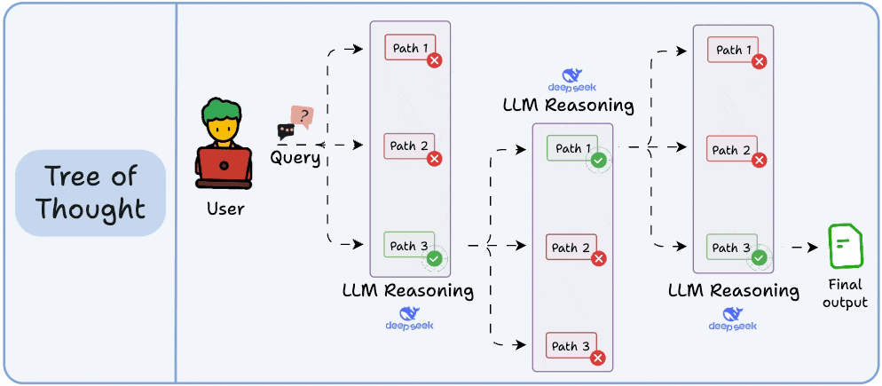
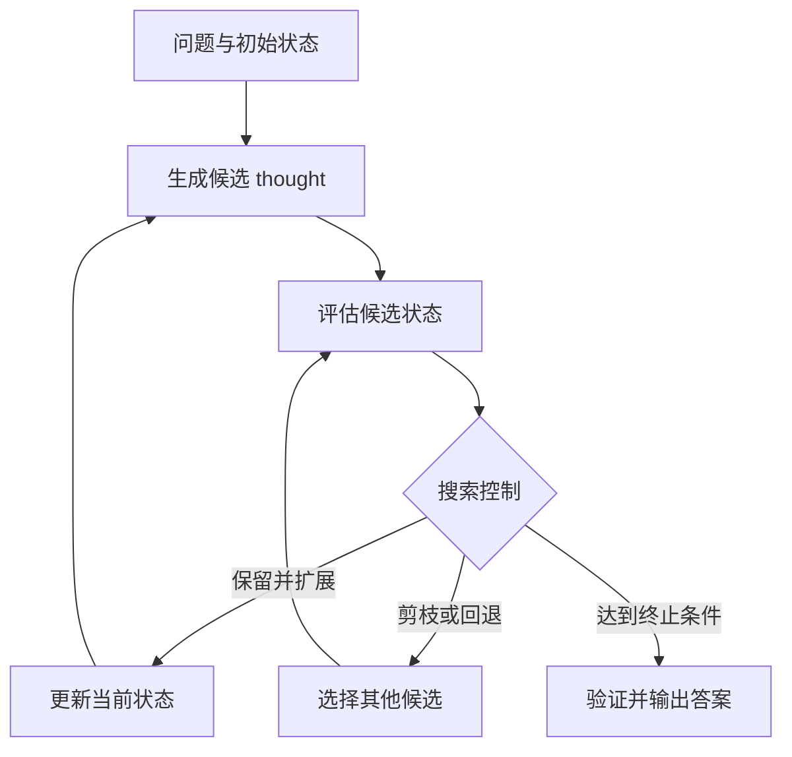

# Tree-of-Thoughts（ToT）：推理时树搜索框架

Tree-of-Thoughts（ToT，思维树）是一种显式搜索多个中间推理状态的求解框架。模型根据问题和当前状态生成候选的下一步，再由评估器和搜索策略决定扩展、保留、剪枝或回退哪些分支。

**定位：** ToT 通过提示、候选生成、状态评估和搜索控制来组织模型在推理阶段的调用，属于推理时计算的一种搜索策略。它把单路径推导扩展为对多个部分解的搜索；实际效果取决于候选生成、状态评估和预算配置。更广义的推理时计算见[02 推理时计算与推理模型](02%20%E6%8E%A8%E7%90%86%E6%97%B6%E8%AE%A1%E7%AE%97%E4%B8%8E%E6%8E%A8%E7%90%86%E6%A8%A1%E5%9E%8B.md)。

这里的 thought 指任务相关的中间表示或部分解，例如一个算式、棋盘填入或计划步骤；它不是对模型隐藏内部状态的直接读取。

## 1. 核心机制

ToT 的实现通常包含以下环节，具体形式按任务设计：

| 环节 | 作用 |
| --- | --- |
| 状态与 thought 定义 | 规定如何表示初始问题，以及每个部分解或中间步骤。 |
| 候选生成 | 让模型从当前状态提出一个或多个可能的下一步。 |
| 状态评估 | 估计候选状态的可行性或进展，可由模型判断、启发式规则或外部验证器提供。 |
| 搜索控制 | 决定扩展哪些状态、保留哪些分支，以及何时剪枝或回退。 |
| 终止与验证 | 达到目标或预算上限时停止；有可靠校验方式时验证完整解。 |

整体流程如下：

常见搜索控制策略包括：

- **广度优先搜索（BFS）**：逐层扩展候选状态。
- **Beam Search**：每一层只保留有限数量的高分状态，可视作带宽度限制的逐层搜索。
- **深度优先搜索（DFS）与回溯**：先沿一条分支深入，遇到死路或低分状态时返回其他候选。

这些是可选的控制策略；ToT 本身不要求同时采用它们，也没有固定的分支数或评估方式。

## 2. 示例：24 点问题

给定数字 2、3、4、6，目标是得到 24。模型可以把当前状态表示为尚未使用的数字和已形成的部分表达式。一个候选步骤是先计算 3 − 2 = 1，状态随之变为剩余数字 1、4、6；继续扩展后得到 (3 − 2) × 4 × 6 = 24。

其他首步会形成不同的子状态。搜索策略负责选择继续探索哪些分支，最终表达式可由算术检查器验证。这个例子体现了 ToT 对部分解进行分支搜索；它不只是一次生成多个完整答案再投票。

## 3. 与相关方法的区别

| 方法 | 组织方式 | 关键区别 |
| --- | --- | --- |
| CoT | 沿一条中间推导路径继续生成。 | 默认不搜索多个部分解分支。 |
| Self-Consistency | 独立采样多条完整推理路径，再聚合最终答案。 | 主要在完整路径或答案层面聚合。 |
| Self-Ask | 把问题拆成一系列子问题并逐个回答。 | 通常沿子问题序列推进，不要求树状分支搜索。 |
| ToT | 生成并评估多个中间状态，再由搜索策略扩展或剪枝。 | 搜索发生在求解过程中的部分状态。 |
| ReAct | 将推理、工具行动和观察结果组成循环。 | 工具执行由运行时负责；ToT 可与工具结合，但工具调用不是 ToT 的定义条件。 |

## 4. 适用场景与局限

| 任务特征 | 示例 | 使用时留意 |
| --- | --- | --- |
| 中间状态清楚，候选进展可比较或验证 | 24 点、填字谜、受约束规划 | 设计能检查部分状态和终局结果的评估方式。 |
| 有多种可探索方案，但评估标准较主观 | 创意写作、大纲构思 | 评分标准可能偏好流畅表达，却未必代表任务质量。 |
| 单步事实查询或直接可答的问题 | 简单问答、查找明确字段 | 树搜索可能只增加调用、延迟和成本。 |

ToT 不保证找到全局最优解。候选生成器可能没有提出正确分支；评估器可能误判局部进展；过早剪枝会丢掉后来能得到好解的路径。模型自评也可能与生成时共享盲点。增加搜索预算只有在候选质量、评估信号和停止规则有效时才可能带来收益。

## 5. 工程使用与评估

使用 ToT 前，先确认任务确实需要探索多个部分解，并且能比较或验证这些状态。实现时应设置：

- 每个状态的候选数、搜索宽度和最大深度。
- 模型生成、评估器及工具调用的总次数或 Token 预算。
- 终止条件、无可行分支时的回退方式，以及预算耗尽后的处理方式。
- 数学、代码、谜题等任务的确定性验证器；开放式任务的明确评分标准或人工评估。

在相同模型、样例和工具条件下，将 ToT 与直接回答、CoT 或较小的候选重排方案比较。记录成功率、分支数、模型与评估器调用数、端到端延迟和成本；若搜索会触发外部工具，权限检查和实际执行由 Agent/Harness 运行时管理。

## 参考资料

- Yao 等，[Tree of Thoughts: Deliberate Problem Solving with Large Language Models](https://arxiv.org/abs/2305.10601)：提出 ToT 框架，并在 24 点、创意写作和迷你填字谜任务中展示不同的候选生成、评估与搜索方式。
