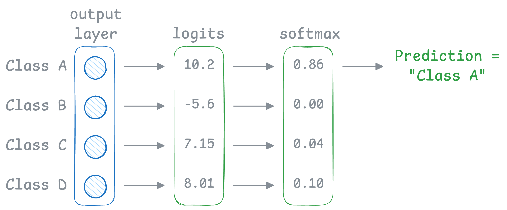
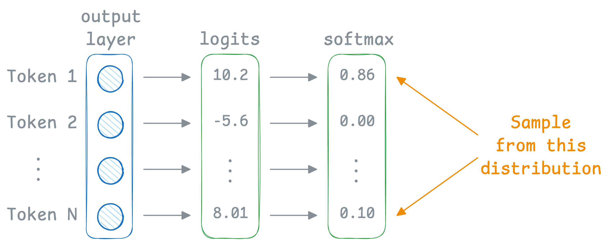
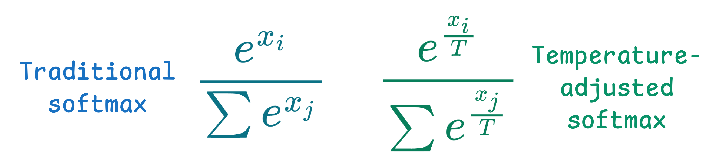
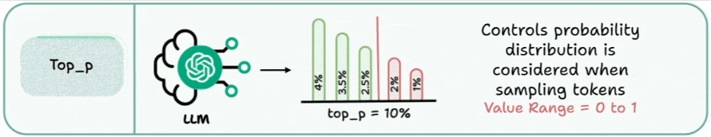
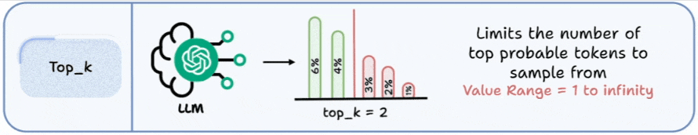
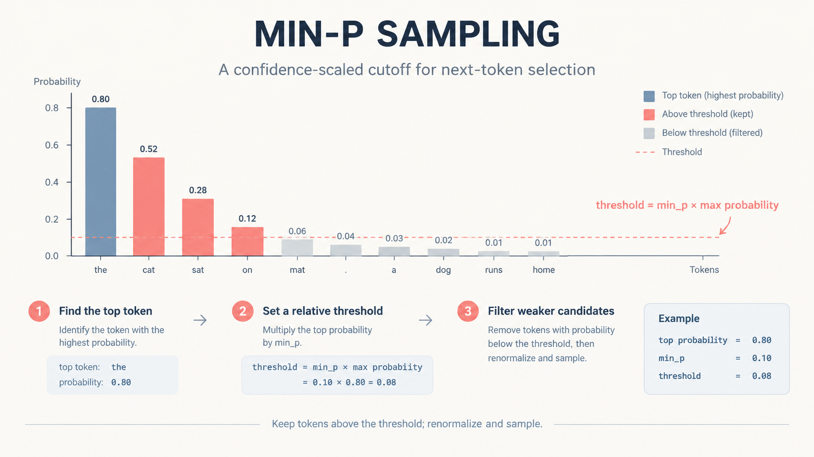
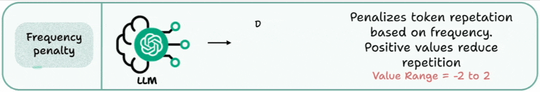
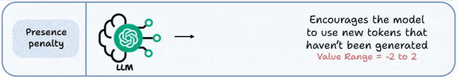

# LLM生成参数详解
## 1. 参数速查

| 参数 | 控制什么 | 常见字段名 | 常见取值 |
| --- | --- | --- | --- |
| 温度 | 候选分布的尖锐程度，即随机性大小 | `temperature` | 0-2，部分平台限 0-1 |
| 核采样 | 按累计概率保留候选集合 | `top_p`、`topP` | 0-1 |
| Top-k | 按数量保留候选 | `top_k`、`topK` | 正整数 |
| Min-p | 按相对最高概率的阈值过滤 | `min_p` | 0-1，通常取较小值 | 
| 频次惩罚 | 按出现次数加重惩罚 | `frequency_penalty` | 常见 -2 到 2 | 
| 存在惩罚 | 已出现过的 Token 是否降分 | `presence_penalty` | 常见 -2 到 2 |
| 重复惩罚 | 引擎自定义的重复抑制规则 | `repetition_penalty` | 通常以 1 为中性 | 
| 输出预算 | 最多生成多少 Token | `max_tokens`、`max_completion_tokens`、`max_output_tokens`、`maxOutputTokens` | 正整数，受模型上限约束 | 
| 停止条件 | 命中字符串即结束生成 | `stop`、`stop_sequences` | 字符串或字符串数组 |
| 分数偏置 | 指定 Token ID 加减分 | `logit_bias`、`logitBias` | Token ID 到偏置值的映射 | 
| 随机种子 | 复现实验的尝试 | `seed` | 整数 | 
| 候选数量 | 一次请求返回多个结果 | `n`、`candidateCount`、`num_return_sequences` | 正整数 | 
| 推理预算 | 内部推理投入多少 | `reasoning.effort`、`thinking.budget_tokens`、`thinkingConfig.thinkingBudget` | 枚举或 Token 数 | 
## 2. 采样与候选过滤

### 2.1 temperature

传统的分类模型使用 softmax 函数，根据所有类别的 logits 值生成最终预测的结果，如下图：

而在 LLM 中，输出是在 softmax 概率分布上采样得到的结果，如下图：

温度变化会对 softmax 函数做如下调整，影响重采样过程：

设第 `i` 个 Token 的 logit 为 `z_i`，温度为正数 `T` 时的常见变换是 `p_i = softmax(z_i / T)`：

- 温度越低，分布越尖锐，最高概率 Token 越突出，抽样几乎总会选中它。
- 温度越高，分布越平坦、越接近均匀，抽样结果越随机。
- `T = 1` 不因温度改变分布；`T = 0` 没有跨 API 的统一语义，有的实现特殊处理为贪心选择，有的会拒绝该值。

常见取值范围与默认值：

| 平台或接口 | 取值范围 | 默认值 | 使用时确认 |
| --- | --- | --- | --- |
| OpenAI | 0-2 | 1 | 部分推理模型只接受默认值，传入其他值会被拒绝。 |
| Anthropic Messages | 0.0-1.0 | 1.0 | 官方说明 0 偏分析、1 偏创意；部分模型进一步锁定采样参数。 |
| Gemini | 0-2 | 随模型 | 未指定时使用模型默认值，需查当前文档。 |
| vLLM | 0-2 | 1.0 | 与 `top_k`、`top_p`、`min_p` 共同作用于同一批 logits。 |
| Transformers | 浮点数 | 1.0 | 只在 `do_sample=True` 时生效，默认为贪心解码。 |

场景起点只是常见做法，上线前应在自己的评测集上验证：

| 场景 | 温度起点 | 说明 |
| --- | --- | --- |
| 信息抽取、分类判定 | 0 或平台最小值 | 优先稳定性，输出用结构化约束。 |
| 代码生成与补全 | 0-0.3 | 惩罚类参数保持默认或为 0，避免破坏重复出现的标识符。 |
| 摘要、RAG 问答 | 0.3-0.7 | 事实性靠上下文与引用，不靠温度。 |
| 通用对话 | 平台默认或 0.7 左右 | 需要风格变化时再上调。 |
| 创意写作、文案、头脑风暴 | 0.8 以上 | 多样性上升，需要人工或规则筛选，常配合 `top_p` 或 `min_p`。 |

**注意点**：

- `temperature` 不是正确率开关，也不会补充模型缺少的知识；调低温度不能消除幻觉。
- 即使固定温度与 `seed`，批处理组合、浮点运算顺序和服务端实现仍可能带来差异。
- 部分推理模型或端点不接受该参数，传入可能被拒绝或忽略。

### 2.2 top_p（nucleus sampling）

按概率从高到低排序，只保留累计概率达到 `p` 的最小候选集合，再在集合内抽样。候选数量随分布形状变化：分布集中时候选少，分布平坦时候选多。

- `top_p = 1` 相当于不做核采样过滤。
- 值越小越保守，但过小会在长文本中造成重复和退化。
- 与 `temperature` 同时收紧容易让候选过少；OpenAI 与 Anthropic 的文档都建议两者只调其中一个。

默认值差异：

| 平台或接口 | 默认值 | 使用时确认 |
| --- | --- | --- |
| OpenAI、Anthropic、vLLM | 1，即不过滤 | 是否同时还调整了温度。 |
| Gemini（`topP`） | 随模型，可能小于 1 | 不传该字段也可能已经在过滤候选。 |
| Transformers | 1.0 | 需 `do_sample=True`；`top_k` 默认 50，会一并生效。 |

### 2.3 top_k

只保留分数最高的 `k` 个候选。候选数量固定，不随分布形状变化：分布很确定时可能保留过多噪声候选，分布很平坦时又可能砍掉合理选项。

- `top_k = 1` 近似贪心解码。
- 常见取值区间在 20-100 之间：太小会限制表达，太大接近不过滤。
- 与 `top_p` 同时启用时，两者先后裁剪候选集合，最终结果取决于实现顺序。

支持情况：

| 平台或接口 | 是否提供 | 默认值 |
| --- | --- | --- |
| OpenAI | 不提供 | — |
| Anthropic Messages | 提供，可选 | 默认不启用，以文档为准 |
| Gemini（`topK`） | 提供 | 随模型，以文档为准 |
| vLLM | 提供 | -1，即关闭 |
| Transformers | 提供 | 50，需 `do_sample=True` |

### 2.4 min_p

按相对阈值过滤：通常保留概率不低于最高候选概率乘以 `min_p` 的 Token。相比 `top_p`，它在分布很确定时自动收紧候选，在分布平坦时保留更多候选；并非所有 API 都支持。

- 取值范围 0-1，`0` 表示关闭，常见起点为 0.05-0.1。
- 与较高温度搭配可以在保留多样性的同时压掉低概率长尾，常用于创意生成。
- 与 `top_k`、`top_p` 叠加会继续收窄候选，容易出现重复或退化。

支持情况：

| 平台或接口 | 是否提供 | 说明 |
| --- | --- | --- |
| OpenAI、Anthropic、Gemini | 不提供 | 需要类似效果时改用 `top_p` 或 `top_k`。 |
| vLLM | 提供 | 取值 0-1，`0` 为关闭。 |
| Transformers | 提供 | `GenerationConfig` 中的 `min_p`，默认为 0。 |
| llama.cpp、Ollama | 提供 | 字段名与默认值以对应版本文档为准。 |

### 2.5 frequency_penalty（频率惩罚）

`frequency_penalty`（频率惩罚）是大语言模型（LLM）文本生成中的一个采样参数，用于降低模型重复使用已经生成过的词语或 Token 的倾向。

它通常通过调整模型生成下一个 Token 时的 logits（未归一化分数）实现，常见计算方式为：

`logits'(x) = logits(x) - α · f(x)`

其中：

- `x`：候选 Token。
- `logits(x)`：模型原始输出分数。
- `α`：frequency_penalty 参数值。
- `f(x)`：该 Token 在当前上下文中已经出现的次数。
- `logits'(x)`：惩罚调整后的分数。

要点：

- 常见取值范围 -2 到 2，默认 0；正值抑制重复，负值鼓励重复。
- 惩罚随出现次数线性加重，长文本中影响更明显。
- 可与 `presence_penalty` 叠加，两者作用于同一批 logits。
- 统计范围是否包含输入提示词、是否只算本轮生成，因实现而异。
- 惩罚过强会破坏代码标识符、专有名词和必要术语的重复，应在目标数据上评估。

### 2.6 presence_penalty（存在惩罚）

`presence_penalty`（存在惩罚）是大语言模型（LLM）文本生成中的一种采样参数，用于降低模型重复使用已经出现过的 Token 的倾向，从而鼓励模型探索新的表达或相关话题。

其计算公式如下：

`z'_i = z_i - α · 1(f_i > 0)`

其中：

- `i`：候选 Token。
- `z_i`：该 Token 的原始 logits。
- `f_i`：该 Token 在相关上下文中已经出现的次数。
- `α`：presence_penalty 参数值。
- `1(f_i > 0)`：指示函数，出现过取 1，否则取 0。
- `z'_i`：惩罚调整后的 logits。

要点：

- 常见取值范围 -2 到 2，默认 0；正值鼓励引入新话题，负值鼓励延续已有内容。
- 只判断 Token 是否出现过，不看次数，同数值下影响弱于 `frequency_penalty`。
- 支持情况与 `frequency_penalty` 大体一致：OpenAI、Gemini、vLLM、llama.cpp、Ollama 提供，Anthropic Messages 不提供。

三类重复抑制参数的区别：

| 参数 | 计分方式 | 中性值 | 常见来源 |
| --- | --- | --- | --- |
| `frequency_penalty` | 减去 `α` 乘以出现次数，加性 | 0 | OpenAI、Gemini、vLLM、llama.cpp |
| `presence_penalty` | 出现过就减去 `α`，加性 | 0 | OpenAI、Gemini、vLLM、llama.cpp |
| `repetition_penalty` | 对已出现 Token 的 logits 乘以系数，乘性 | 1 | Transformers、vLLM、llama.cpp（`repeat_penalty`） |

三者语义不等价，同时启用时效果会相互放大；`repetition_penalty` 的计数范围通常包含输入提示词，需按实现文档确认。

### 2.7 参数组合与调参顺序

各参数的处理顺序因实现而异，同一个组合在不同引擎上可能得到不同的候选集合。实践建议：

1. 先确认目标平台支持哪些参数、默认值是什么；未支持的参数可能被拒绝，也可能被静默忽略。
2. 优先使用模型推荐配置，不要默认传入全部字段。
3. 一次只调整一个参数，用代表性样例评估正确性、格式合规性、重复率、延迟和成本。
4. 多个过滤器叠加会持续收窄候选：`top_k`、`top_p`、`min_p` 同时收紧容易出现重复、退化或答非所问。
5. 惩罚类参数与过滤器同时加强时输出可能变得不自然，代码、术语表和结构化内容尤其敏感。
6. 需要稳定的输出形状时，靠结构化输出与本地校验，而不是靠压低温度或加重惩罚。
7. 参数只改变怎么选，不改变知道什么；幻觉和知识缺口要在数据、检索与提示词层面解决。

## 参考资料

- [Hugging Face Transformers：GenerationConfig](https://huggingface.co/docs/transformers/main_classes/text_generation#transformers.GenerationConfig)：温度、Top-k、Top-p、Min-p 与惩罚等生成参数。
- [Hugging Face 博客：Min P Sampling](https://huggingface.co/posts/joaogante/319451541682734)：`min_p` 的动机与推荐取值。
- [vLLM：SamplingParams](https://docs.vllm.ai/en/stable/api/vllm/sampling_params/)：开源推理服务的采样参数定义。
- [OpenAI API：Chat Completions](https://developers.openai.com/api/docs/api-reference/chat-completions)：`temperature`、`top_p`、`frequency_penalty`、`presence_penalty`、`logit_bias` 等字段的取值范围与默认值。
- [Anthropic API：Messages](https://platform.claude.com/docs/en/api/messages)：消息接口的生成参数与取值范围。
- [Gemini API：Generate content](https://ai.google.dev/gemini-api/docs/generate-content) 与 [API reference](https://ai.google.dev/api/generate-content)：生成配置字段名与取值范围。