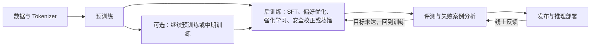

# 一 大模型完整训练链路

如果只看单个概念，`预训练`、`SFT`、`偏好对齐`、`部署` 很容易被理解成彼此独立；但从系统视角看，它们通常属于一条连续链路。

可以先用一句话概括：

`数据与 Tokenizer -> 预训练 ->（可选）继续预训练/中期训练 -> 后训练（SFT、偏好优化、强化学习或安全校正）-> 评测与迭代 -> 发布和推理部署`

这条链路里，每一阶段解决的问题并不一样：

- 预训练：让模型获得语言能力、知识和通用表示能力
- 后训练：让模型更适合指令、偏好、推理、工具使用和安全目标
- 评测与迭代：验证能力变化，定位回归和失败模式；指标说明见 [09 Benchmark与常见指标](09%20Benchmark%E4%B8%8E%E5%B8%B8%E8%A7%81%E6%8C%87%E6%A0%87.md)。
- 推理部署：让模型在真实系统里可用、可控、可负担。

这是一种常见的组织方式，不是所有团队都会使用相同阶段或固定顺序。后训练可能多轮进行，也可能按目标加入推理强化、蒸馏或专门的安全训练。

## 1.1 为什么预训练重要

从头训练大规模语言模型时，预训练通常是资源消耗最大的阶段之一，也为模型建立广泛的语言建模能力和知识基础。它对能力表现有重要影响，但不是唯一决定因素。

原因：

- 预训练从大规模语料中学习通用语言模式、知识和表示能力。
- 后训练能显著调整指令遵循、任务行为和偏好；推理时计算、工具与检索也会影响具体任务表现。
- 最终表现取决于数据、模型架构、训练计算、后训练目标和推理方式的组合。

可以粗略理解为：

- 预训练打下通用建模基础。
- 后训练把基础能力适配到具体交互、任务和约束。

# 二 预训练流程在做什么

## 2.1 数据准备

预训练的第一步不是直接开始训练，而是先准备大规模语料。

常见数据来源包括：

- 网页文本
- 书籍
- 代码
- 论文
- 问答语料
- 多语言文本

数据准备通常要做的事情包括：

- 去重
- 清洗脏数据
- 过滤低质量文本
- 去除明显无意义内容
- 控制不同语料的配比
- 必要时做数据增强和持续更新

这一阶段非常重要，因为：

- 垃圾数据会直接污染模型能力
- 数据分布会影响模型的知识结构和风格
- 数据质量问题会在后面被成倍放大

高质量、多样化的数据集，往往比“单纯堆更多数据”更重要。

真实训练数据管线还需管理来源和版本，并关注版权许可、个人信息、近重复内容、基准污染、多语言比例和领域覆盖。合成数据能补充稀缺任务，但需要过滤、去重和质量评估；未经检查地循环使用模型生成内容，可能放大原有错误和偏差。

## 2.2 Tokenization

原始文本不能直接送进神经网络，所以要先经过分词器，切成 token。

这一步和前面的 [01 LLM基本概念.md](01%20LLM%E5%9F%BA%E6%9C%AC%E6%A6%82%E5%BF%B5.md)、[04 Embedding.md](04%20Embedding.md) 是连起来的：

1. 文本先被切成 token
2. token 再映射成 id
3. id 再查表变成向量
4. 向量进入 Transformer 计算

所以 tokenization 是训练链路里很靠前、但影响很深的一步。

## 2.3 训练目标

对于自回归语言模型来说，最常见的预训练目标是：

**给定前文，预测下一个 token。**

例如：

```text
输入：今天天气很
目标：预测下一个 token
```

模型不会直接记一句完整标准答案，而是不断重复下面这个过程：

1. 读入一段上下文
2. 预测下一个 token 的概率分布
3. 计算预测和真实 token 之间的差距
4. 反向传播，更新参数

## 2.4 Loss 是怎么来的

预训练时，模型每一步都会输出一个对整个词表的预测分布。

如果真实下一个 token 是某个词，而模型给它的概率太低，就会产生更大的损失（loss）。

所以从直觉上看：

- 预测越准，loss 越低
- 预测越偏，loss 越高

训练的目标，就是不断让平均 loss 降下来。

## 2.5 训练为什么这么贵

从头训练大规模模型时，预训练通常是资源消耗最大的阶段之一，但并非所有项目都如此；大规模后训练，尤其是多轮生成式强化学习，也可能占用显著资源。成本会受到训练 Token 数、序列长度、模型规模、训练步数、硬件利用率和实验次数共同影响。

Transformer 训练会在大量 Token 上反复计算和更新参数，并不只是“把数据读一遍”。评估训练成本时，也要把失败实验、重跑和后训练纳入整体预算；参数量本身不足以推断总成本。

# 三 预训练之后发生什么

## 3.1 微调（Fine-tuning）在这里扮演什么角色

预训练后的模型，本质上更像一个强大的“续写器”。

它可能有知识，但不一定擅长：

- 按角色回答
- 按格式输出
- 遵循任务约束
- 以助手方式互动

所以通常需要进入“微调”阶段。

但要注意，**微调不是单一方法名，而是一类适配过程。**

在大模型实践里，微调常见有两种理解：

- 狭义微调：主要指 SFT（监督微调）
- 广义微调：泛指在基础模型上继续做任务适配或领域适配

因此当大家说“给模型做微调”时，可能实际指的是：

- 用指令数据做 SFT
- 用领域数据做任务适配
- 用 LoRA / QLoRA 这类参数高效方法训练

## 3.2 指令微调（SFT）

SFT（Supervised Fine-Tuning）使用带有目标输出的监督样本继续训练模型。常见数据是“指令-回答”对，也可以包括多轮对话、结构化输出、工具调用或其他任务样本。训练数据定义了希望模型学习的行为，实际效果取决于样本质量、覆盖范围和训练目标。

这一步主要解决：

- 更听指令
- 更符合问答格式
- 更贴近具体任务
- 更接近助手式交互

可以把它理解为：

- 预训练解决“模型会不会语言和知识”
- SFT 解决“模型会不会按要求回答”

## 3.3 微调方法和训练阶段不是一回事

还要再区分一层：

- `SFT / 领域微调`：说的是训练目标和训练阶段
- `Full Fine-tuning / LoRA / QLoRA / Adapter`：说的是参数更新方式

也就是说：

- 你可以做一个 SFT 任务
- 但这个 SFT 既可以用全参数微调完成，也可以用 LoRA 完成

这也是为什么“微调”这个词特别容易混淆。

更具体的微调方法，可继续看 [07 微调.md](07%20%E5%BE%AE%E8%B0%83.md)。

## 3.4 偏好对齐

SFT 之后，模型已经能回答问题，但“能回答”和“回答得更好”不是一回事。

所以很多模型还会继续做偏好对齐，目标通常包括：

- 更安全
- 更有帮助
- 更符合人类偏好
- 在推理和工具使用中表现更稳定

常见方法包括：

- 奖励模型 + RLHF
- DPO 等偏好优化方法
- PPO、GRPO 等策略优化方法

后训练阶段的范围和术语边界见 [06 后训练概述.md](06%20%E5%90%8E%E8%AE%AD%E7%BB%83%E6%A6%82%E8%BF%B0.md)，强化学习方法见 [08 强化学习.md](08%20%E5%BC%BA%E5%8C%96%E5%AD%A6%E4%B9%A0.md)。

## 3.5 蒸馏与能力迁移

蒸馏是利用教师模型的输出、评分、轨迹或中间监督信号训练学生模型的一类方法。常见目标是把较强模型的能力迁移到更小、更便宜或更适合特定部署环境的模型中。

蒸馏可以发生在后训练流程的不同位置，也常用于推理模型家族的轻量版本。它不等于简单缩小参数量：学生模型需要在目标任务上重新评估，还要检查错误类型、格式稳定性和安全表现。蒸馏与 LoRA 等参数高效微调解决的是不同问题。

# 四 继续预训练、领域微调、RAG 的区别

这几个概念经常被混在一起，但它们不属于同一层。

## 4.1 继续预训练

继续预训练（continued pretraining）指的是：

在已有基础模型上，再用特定领域的大规模语料继续做预训练。

一些团队会把预训练结束后、指令微调前的一段高质量混合语料训练称为中期训练（mid-training）。术语边界并未完全统一；理解时重点看训练目标、数据分布和它在整体训练链路中的位置。

它更适合解决：

- 模型缺少某个领域的语言分布
- 模型对某类文本风格不熟
- 希望增强领域知识基础

例如：

- 法律文本
- 医学文献
- 金融报告
- 企业内部专业文档

## 4.2 领域微调

领域微调更像是：在特定任务样本上，让模型学会该领域里的具体输出方式。

它更偏：

- 任务适配
- 指令适配
- 输出风格适配

所以可以粗略理解为：

- 继续预训练：补领域基础知识和语言分布
- 领域微调：补领域任务表现

## 4.3 RAG

RAG 通常是一种运行时应用模式，而不是把外部知识写入生成模型参数的训练阶段。检索器、重排器和生成模型本身仍可单独训练或微调；这里讨论的是典型 RAG 系统的使用流程。

它的核心思路是：

- 先从外部知识库检索相关内容
- 再把这些内容放进上下文
- 最后让模型基于这些内容回答

所以 RAG 解决的是：

**模型不需要把所有知识都重新训练进参数里，也能在回答时访问外部知识。**

## 4.4 工具调用

工具调用横跨训练与运行时：后训练可教模型判断何时调用工具并生成结构化调用；运行时系统负责校验、授权和执行调用，并把结果返回给模型。实际执行 API 或代码属于应用/Agent 运行层，不是模型训练阶段本身。

它解决的是：

- 查询外部系统
- 执行代码
- 访问数据库
- 调用 API

因此不要把继续预训练、微调、RAG 和工具调用看成同一类事情：继续预训练和微调会更新模型参数；RAG 与工具执行属于运行时架构，而模型如何发起工具调用可以通过后训练学习。

# 五 训练完成后为什么还要部署优化

模型训练完成，不代表系统就能直接上线。

推理部署还要解决很多工程问题，例如：

- 延迟
- 成本
- 吞吐
- 显存占用
- 并发
- 安全与权限控制

这也是为什么一个模型“效果很好”，不一定意味着它“系统可用”。

训练阶段影响能力形成，部署阶段决定这些能力能否稳定提供给真实用户。延迟、吞吐、量化和服务架构等内容见 [推理与部署](../../04%20%E6%8E%A8%E7%90%86%E4%B8%8E%E9%83%A8%E7%BD%B2/README.md)。



# 参考资料

- [Training Compute-Optimal Large Language Models](https://arxiv.org/abs/2203.15556)：计算量、参数规模与训练 Token 的权衡。
- [Training language models to follow instructions with human feedback](https://arxiv.org/abs/2203.02155)：指令微调与 RLHF 的公开实践。
- [Direct Preference Optimization: Your Language Model is Secretly a Reward Model](https://arxiv.org/abs/2305.18290)：基于偏好数据的直接优化方法。
- [DeepSeek-R1](https://arxiv.org/abs/2501.12948)：推理模型后训练与强化学习的公开实践。
