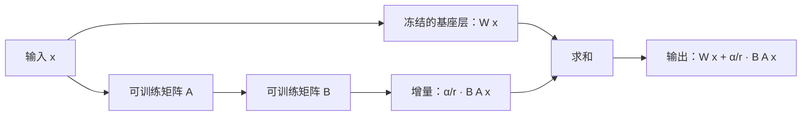
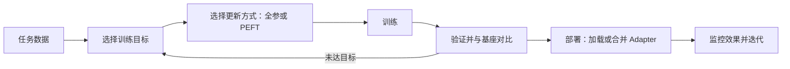

# 微调

## 微调在大模型训练链路里的位置

微调（Fine-tuning）是指：在已经训练好的基础模型上，再用特定数据继续训练，让模型更适合目标任务或目标场景。

放到完整训练链路里，常见路径可以粗略表示为：

`预训练 ->（可选）继续预训练 -> 后训练（SFT、偏好优化或安全调整，按目标选择并可能多轮迭代）-> 评测与部署`

微调和后训练的整体流程见 [05 大模型训练流程](05%20%E5%A4%A7%E6%A8%A1%E5%9E%8B%E8%AE%AD%E7%BB%83%E6%B5%81%E7%A8%8B.md) 与 [06 后训练概述](06%20%E5%90%8E%E8%AE%AD%E7%BB%83%E6%A6%82%E8%BF%B0.md)。

- 预训练建立通用建模基础。
- 微调可以提高模型在目标任务上的适配程度，但效果取决于数据和训练方式。
- 偏好优化、安全校正等后训练目标按需要选择，并非所有模型都必须经过同一套阶段。

因此，讨论微调时要说明具体训练目标和阶段，而不是把它当成从零训练模型。

### 为什么需要微调

预训练后的模型通常更像一个通用续写器，它可能已经具备：

- 语言理解能力
- 基础知识
- 基础推理能力

但它未必天然擅长：

- 按指令回答
- 输出固定格式
- 适应某个具体业务任务
- 使用某个领域的话语风格

这就是微调的意义：**让通用模型更贴近实际任务。**

### 微调不等于所有“后续训练”

“微调”有广义和狭义用法，最好同时说明训练目标和参数更新方式：

- `continued pretraining`：继续预训练，通常延续基础模型的预训练目标，以适配新的语料分布或领域。
- `SFT`：使用输入与目标输出样本做监督训练，是常见的指令或任务适配方式。
- `偏好优化 / RLHF`：后训练中的偏好对齐目标或训练流程。DPO 是一种直接偏好优化方法；RLHF 通常指利用人类反馈构造奖励并优化模型的流程。

因此：

- 狭义的“微调”通常指 SFT 或任务适配；广义上也可能泛指从预训练模型继续进行的参数训练。
- 继续预训练与监督微调的训练目标不同，描述时应明确区分。
- 偏好优化可以被宽泛地称为偏好微调，但它描述训练目标或流程；LoRA、QLoRA、Adapter 等描述参数更新方式，两者不是同一分类轴。

强化学习和偏好优化的具体关系见 [08 强化学习](08%20%E5%BC%BA%E5%8C%96%E5%AD%A6%E4%B9%A0.md)。

## 微调主要在解决什么问题

### 任务适配

让模型在具体任务上表现更好，例如：

- 问答
- 摘要
- 分类
- 信息抽取
- 代码补全

### 指令适配

让模型更像一个“助手”，而不是只会机械续写文本。

例如：

- 更理解用户指令
- 更遵循输出格式
- 更稳定执行任务约束

### 领域适配

让模型更适应某个专业领域的表达方式、知识结构和输出风格，例如：

- 医疗
- 法律
- 金融
- 企业内部知识

### 风格适配

让模型输出更符合目标风格，例如：

- 更正式
- 更简洁
- 更像客服
- 更像内部助手

## 微调的两种主线

### 按训练目标分

如果按“想让模型学会什么”来分，常见有两类：

#### 监督微调（SFT）

用“输入-输出”配对数据训练模型。

例如：

- 指令 -> 回答
- 问题 -> 答案
- 文本 -> 分类标签

这是常见的指令和任务适配方式之一。

#### 领域任务微调

和 SFT 类似，但数据和目标更偏具体业务场景。

例如：

- 法律问答
- 医疗报告生成
- 企业知识助手

### 按参数更新方式分

如果按“到底更新多少参数”来分，常见有两类：

- 全参数微调（Full Fine-tuning）
- 参数高效微调（PEFT，Parameter-Efficient Fine-Tuning）

这里要特别区分：

- `SFT` 是训练目标
- `LoRA / QLoRA / Adapter / Prefix-Tuning` 是训练手段

所以：

- 可以做一个 SFT 任务
- 但这个任务既可以用全参数微调完成，也可以用 LoRA 完成

## 常见微调方法

### 全参数微调（Full Fine-tuning）

全参数微调的意思是：训练时更新模型的大部分或全部参数。

特点：

- 可以更新全部或大部分模型参数，适配空间较大。
- 在数据和算力充足、训练目标合适时，可能优于参数高效方法；但不保证在每个任务上都更好。

主要代价：

- 计算、显存和优化器状态开销较大。
- 数据不足或训练设置不当时，仍可能过拟合或损伤原有能力。
- 训练和存储成本较高。

它更适合：

- 资源充足
- 模型规模相对可控
- 对任务效果要求很高

### LoRA

LoRA（Low-Rank Adaptation）是应用广泛的参数高效微调方法之一。

它的核心思想不是直接改完整权重，而是：

- 冻结原模型大部分参数
- 只训练额外的低秩增量矩阵
- 用这些小矩阵去近似表示参数更新

所以 LoRA 的重点是：**冻结大部分基座权重，用较少的可训练参数学习权重增量；效果是否接近全参数微调取决于任务、数据、秩和目标模块，不能预先保证。**

优点：

- 可训练参数及其优化器状态通常较少。
- 适配权重体积小，便于保存和切换任务。

需要评估的代价：

- 效果依赖秩、目标模块、数据和训练设置，不一定达到全参数微调的结果。
- 单独加载 Adapter 可能增加推理开销；是否能合并权重取决于模型、量化方式和部署实现。

LoRA 可概括为在基座层输出上叠加一个低秩增量：

其中 `α/r` 是常见的缩放项；具体缩放规则会随实现或变体而异。

### QLoRA

QLoRA 在冻结的基座模型上使用量化权重，并训练 LoRA Adapter，以降低微调时的显存需求。原始论文使用 4-bit NormalFloat（NF4）、双重量化和分页优化器；后续实现的量化格式与训练细节可能不同。

量化通常有助于在有限显存中训练，但不保证训练更快或效果与全精度基座完全相同。实际效果取决于量化方案、硬件、软件实现和任务数据。

可以粗略区分：

- LoRA：减少需要训练和保存的参数。
- QLoRA：进一步量化冻结的基座权重，降低训练时的显存占用。

### Prefix-Tuning 与 P-Tuning

这类方法属于软提示（soft prompt）类参数高效适配，但具体实现并不相同：

- Prefix-Tuning 为模型加入可训练的连续前缀表示，具体注入位置依实现而异，可作用于多层注意力的前缀状态。
- P-Tuning 学习连续提示向量；P-Tuning v2 等变体还会在多个 Transformer 层加入深层提示。

它们通常冻结大部分基座参数，只训练提示参数。效果取决于模型结构、任务和实现；不能把 Prefix-Tuning 与所有 P-Tuning 变体都等同为“只在输入侧加前缀”。

软提示方法参数开销小，但不同模型和框架的支持程度不同。选择时应在目标任务上与 LoRA 等方案比较。

### Adapter

Adapter 的思路是：在模型层之间插入小型适配模块，只训练这些新增模块。

优点：

- 参数量小
- 不同任务可以挂不同 Adapter
- 多任务共存更方便

缺点：

- 结构会比 LoRA 稍重
- 工程复杂度可能更高

## 微调的一般流程

### 数据准备

先准备高质量任务数据，例如：

- 指令-回答对
- 分类标注数据
- 问答对
- 结构化输出样本

这一阶段通常要做：

- 清洗
- 去重
- 格式统一
- 划分训练集、验证集和独立测试集；避免近重复或同源样本跨集合造成评估泄漏

### 选择训练目标

先明确你到底要让模型学会什么：

- 更好执行指令
- 更好适应领域任务
- 更稳定输出某种格式

目标不同，数据形式和评估方式也会不同。

### 选择参数更新方式

常见选择包括：

- 全参数微调
- LoRA
- QLoRA
- Adapter
- Prefix-Tuning

这一选择本质上是在权衡：

- 效果上限
- 显存成本
- 训练速度
- 部署便利性

### 训练与评估

训练时通常会关注：

- 训练 loss
- 验证集效果
- 是否过拟合
- 输出风格是否偏移

除了自动指标，也常需要做人工抽样评估，因为很多生成任务很难只靠单个分数说明问题。评估应与基座模型和未微调版本对照；常见指标的适用范围见 [09 Benchmark与常见指标](09%20Benchmark%E4%B8%8E%E5%B8%B8%E8%A7%81%E6%8C%87%E6%A0%87.md)。

### 部署与使用

训练完成后，还要考虑：

- 模型如何部署
- LoRA 权重如何加载
- 是否需要和基座模型合并
- 是否支持多任务切换

所以微调不是“训完就结束”，后面还有工程落地问题。

微调是一条从数据准备到上线评估的流程：

## 什么时候该微调，什么时候不该微调

适合微调的场景：

- 任务模式比较稳定
- 输出格式要求明确
- 有足够高质量样本
- 希望长期复用某种能力

不一定要先微调的场景：

- 问题主要是知识缺失，但外部知识可检索
- 需求变化很快，样本不稳定
- 只需要通过 Prompt、RAG、工具调用就能解决

所以很多时候，问题不一定是“模型需要微调”，而可能是：

- 上下文没给够
- RAG 没做好
- 工具调用没接好

## 一句话总结

如果说：

- 预训练决定模型有没有基础能力
- 偏好对齐决定模型更偏向怎样行为

那么：

- 微调可以帮助模型把通用能力适配到具体任务；是否稳定有效要通过目标评测确认

其中，SFT 描述监督训练目标；LoRA、QLoRA 和 Adapter 描述参数更新方式。它们可以组合使用，但不保证在所有模型和任务上都以相同成本或效果运行。

## 参考资料

- [LoRA: Low-Rank Adaptation of Large Language Models](https://arxiv.org/abs/2106.09685)
- [QLoRA: Efficient Finetuning of Quantized LLMs](https://arxiv.org/abs/2305.14314)
- [Prefix-Tuning: Optimizing Continuous Prompts for Generation](https://arxiv.org/abs/2101.00190)
- [P-Tuning v2: Prompt Tuning Can Be Comparable to Fine-tuning Universally Across Scales and Tasks](https://arxiv.org/abs/2110.07602)
- [Parameter-Efficient Transfer Learning for NLP](https://arxiv.org/abs/1902.00751)
